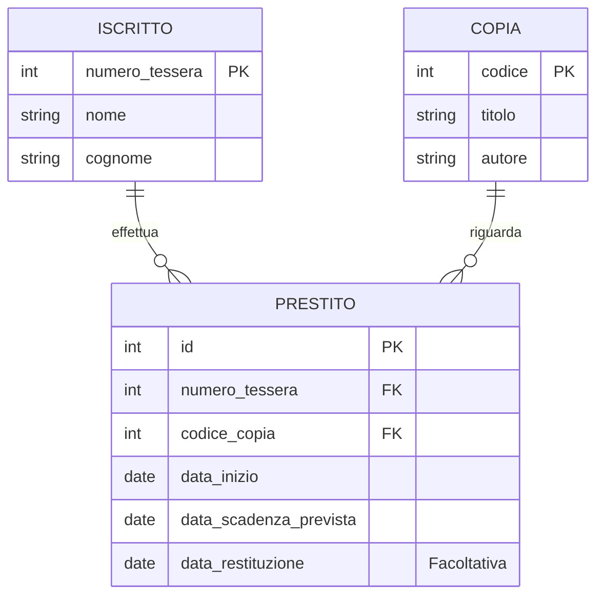
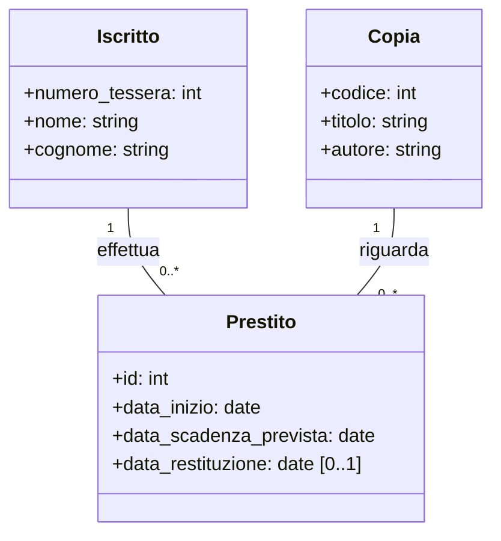

# Esercizio 01: Prestiti in biblioteca — Soluzione di riferimento

## Modello ER

## Diagramma delle classi UML

## Vincoli

- Ogni prestito fa riferimento obbligatoriamente a un iscritto e a una copia esistenti. Iscritti e copie possono esistere anche senza prestiti.
- La data di restituzione è assente finché il prestito è attivo. Per una copia può esistere al massimo un prestito senza data di restituzione: questo vincolo condizionale non è rappresentato dalle sole cardinalità.
- Un vincolo `UNIQUE` sulla sola chiave esterna della copia non sarebbe corretto: impedirebbe anche di conservare più prestiti conclusi della stessa copia.
