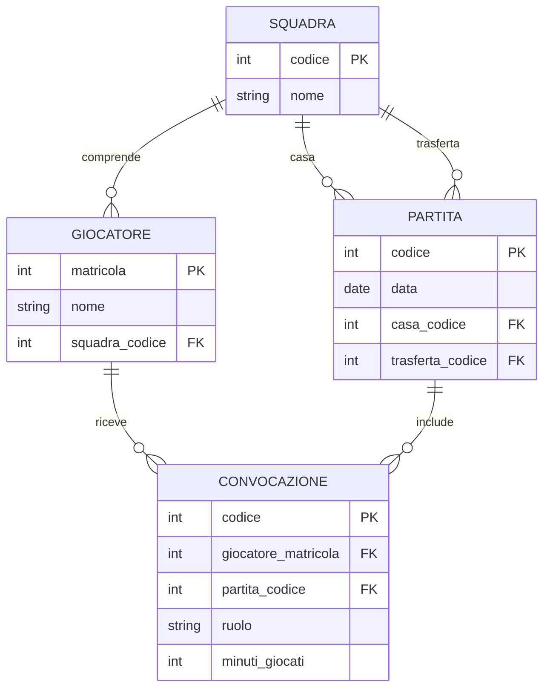
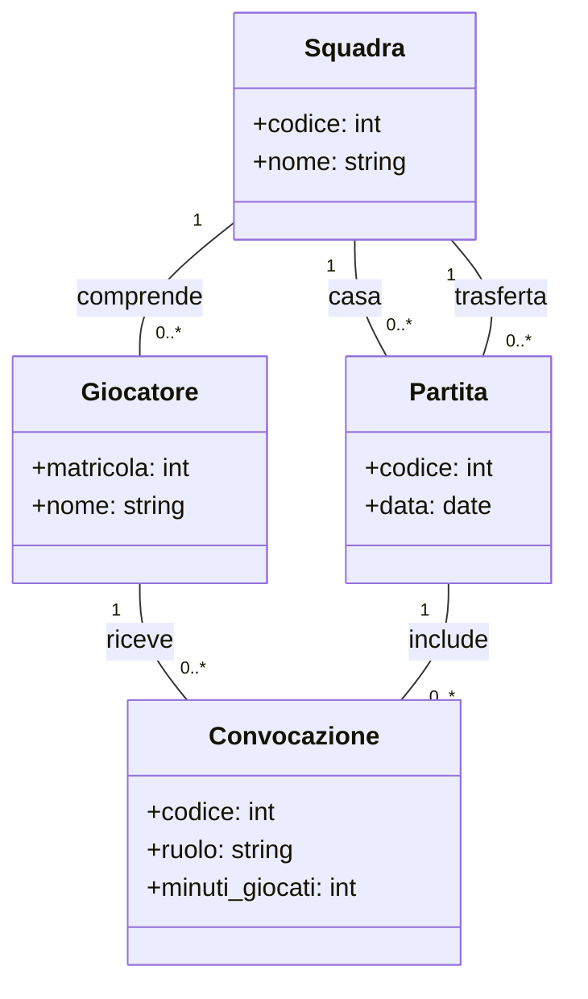

# Esercizio 02: Soluzione di riferimento

- Le due squadre della partita devono essere diverse. La coppia giocatore-partita è univoca.
- La squadra del giocatore convocato deve coincidere con quella di casa o di trasferta; questo controllo richiede di confrontare più relazioni.
