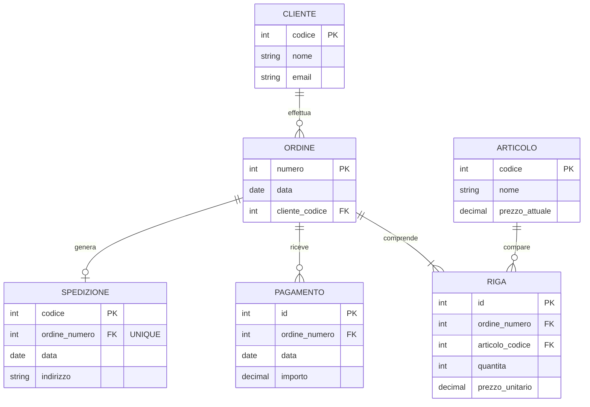
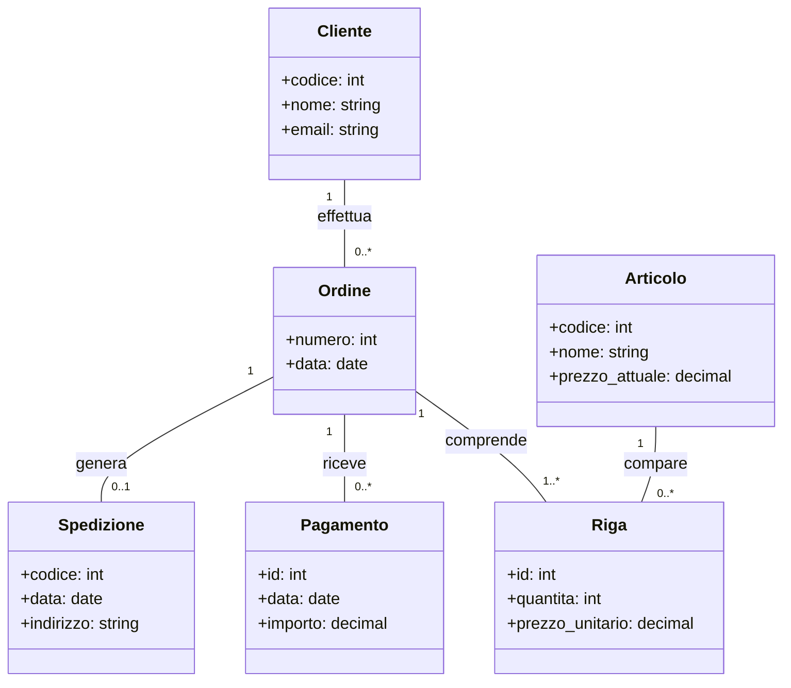

# Esercizio 04: Soluzione di riferimento

- La coppia ordine-articolo è univoca. Il prezzo nella riga conserva quello applicato, anche se il prezzo di catalogo cambia.
- La FK della spedizione è obbligatoria e univoca; l'ordine può non avere spedizione. La presenza di almeno una riga per ordine richiede un controllo aggiuntivo nel database.
