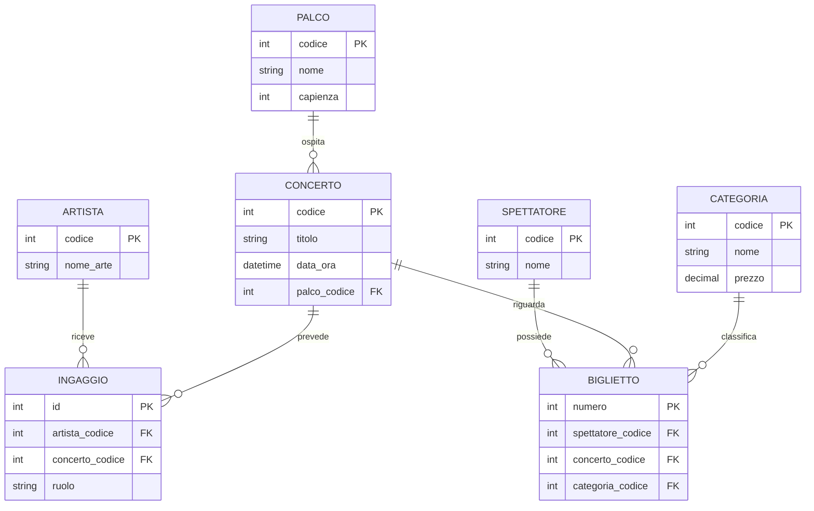
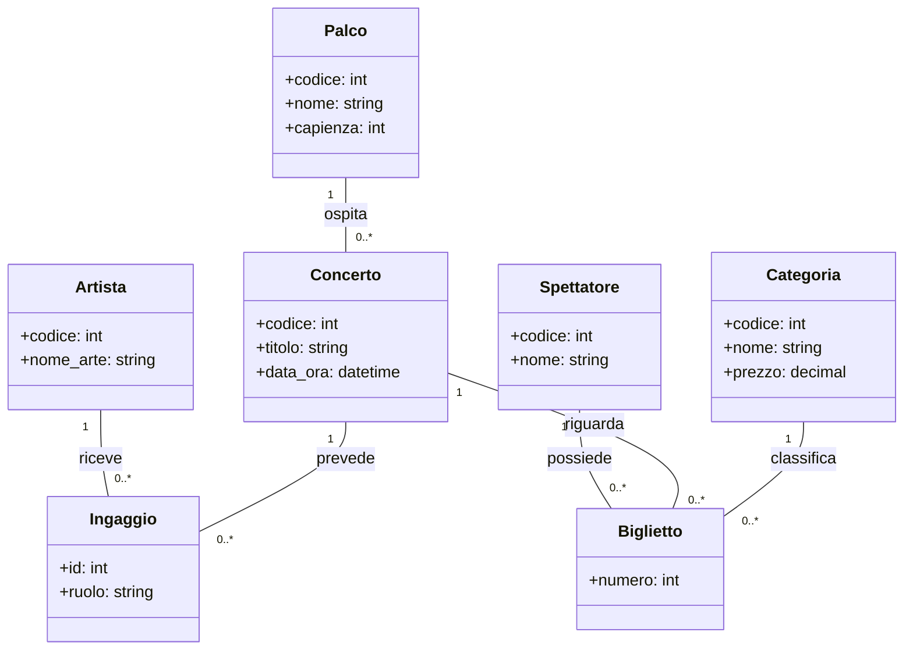

# Esercizio 05: Soluzione di riferimento

- La coppia artista-concerto è univoca. Il conteggio dei biglietti di un concerto non può superare la capienza del relativo palco: le cardinalità da sole non impongono questo vincolo.
