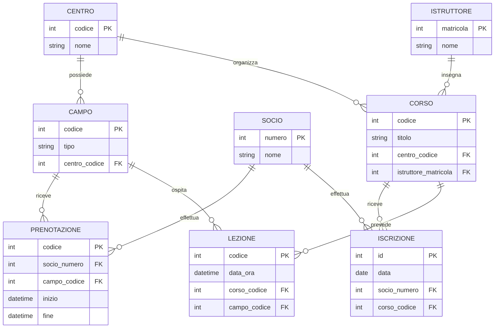
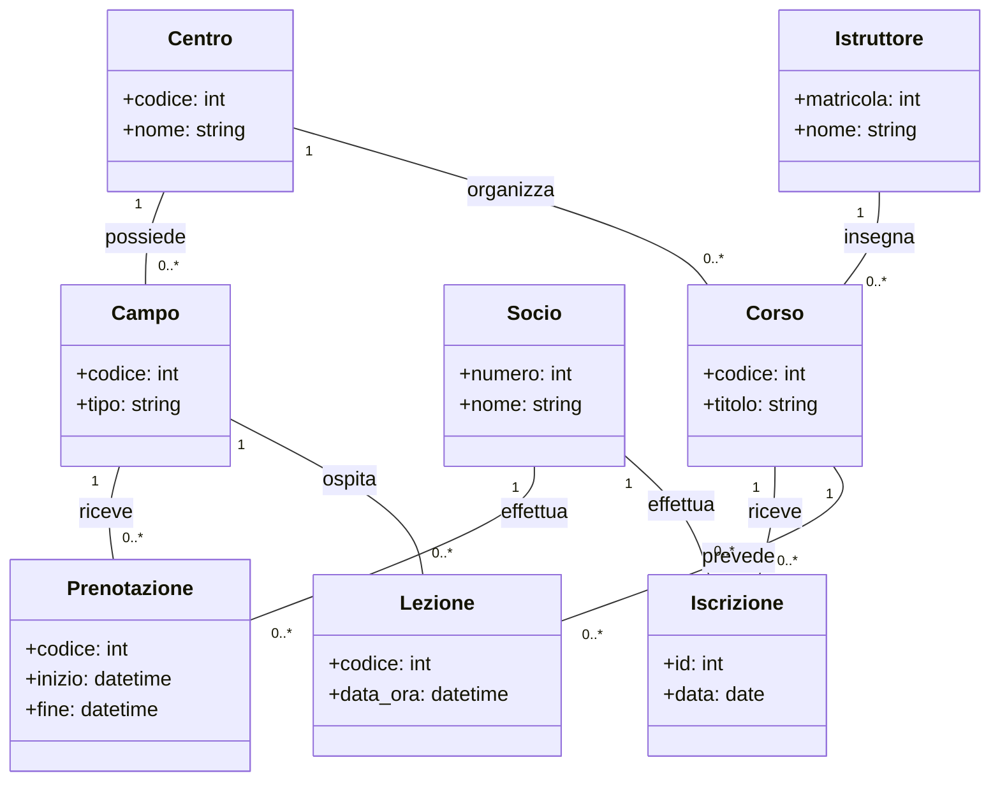

# Esercizio 06: Soluzione di riferimento

- La coppia socio-corso è univoca. L'inizio di una prenotazione precede la fine; intervalli di prenotazione dello stesso campo non si sovrappongono.
- Il centro del campo di una lezione deve coincidere con il centro del corso; la sola presenza delle FK non garantisce il vincolo.
