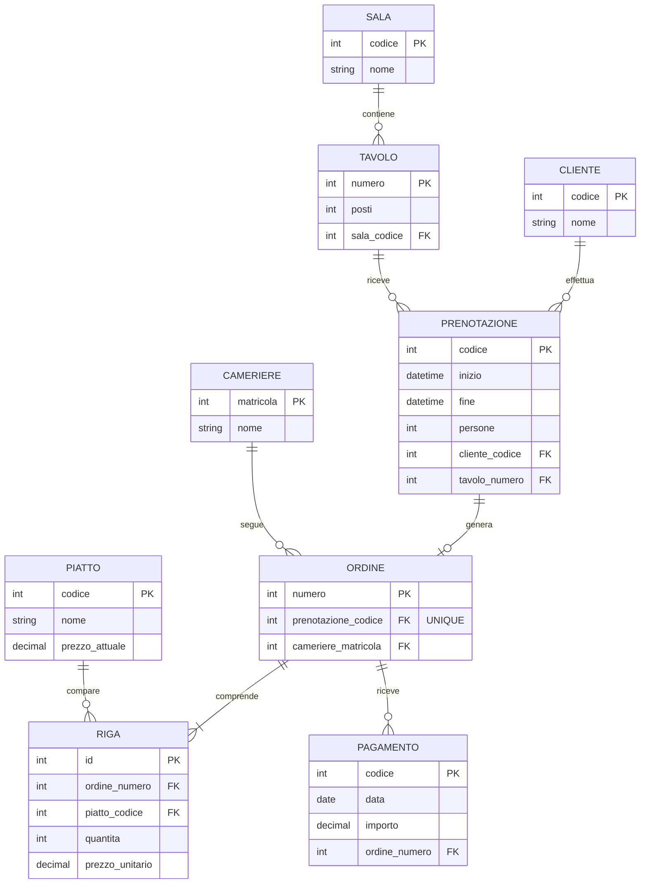
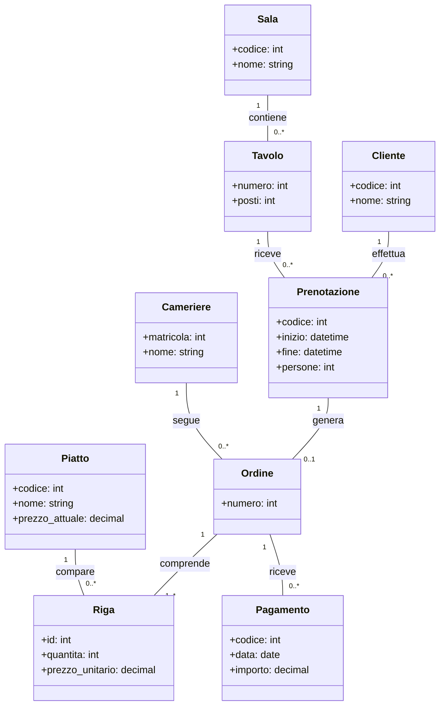

# Esercizio 07: Soluzione di riferimento

- La FK dell'ordine verso la prenotazione è obbligatoria e univoca. La coppia ordine-piatto è univoca; il prezzo della riga conserva quello applicato.
- La prenotazione deve terminare dopo l'inizio, non sovrapporsi alle altre dello stesso tavolo e rispettarne il numero di posti. L'ordine deve avere almeno una riga: sono necessari controlli aggiuntivi.
