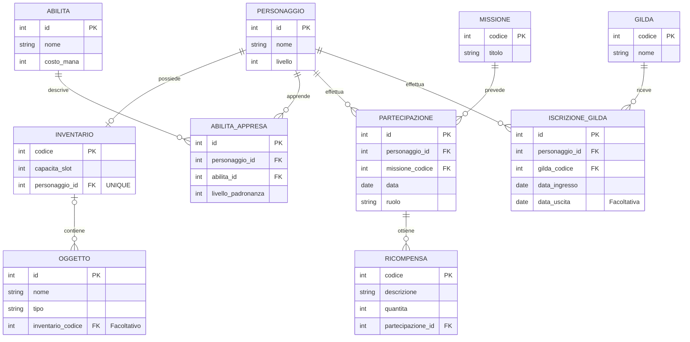
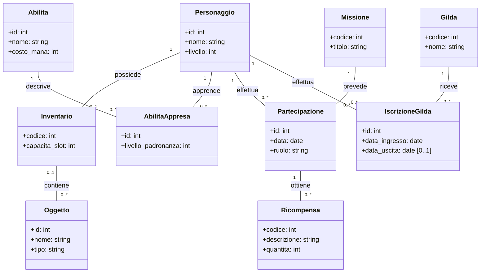

# Esercizio 08: Soluzione di riferimento

- La FK dell'inventario verso il personaggio è obbligatoria e univoca; quella dell'oggetto verso l'inventario è facoltativa. Il numero di oggetti non deve superare la capacità.
- Sono univoche le coppie personaggio-abilità e personaggio-missione; la padronanza è compresa tra 1 e 5.
- Per ogni personaggio può esistere al massimo un'iscrizione senza data di uscita. Un `UNIQUE` sulla sola FK del personaggio impedirebbe erroneamente di conservare lo storico.
